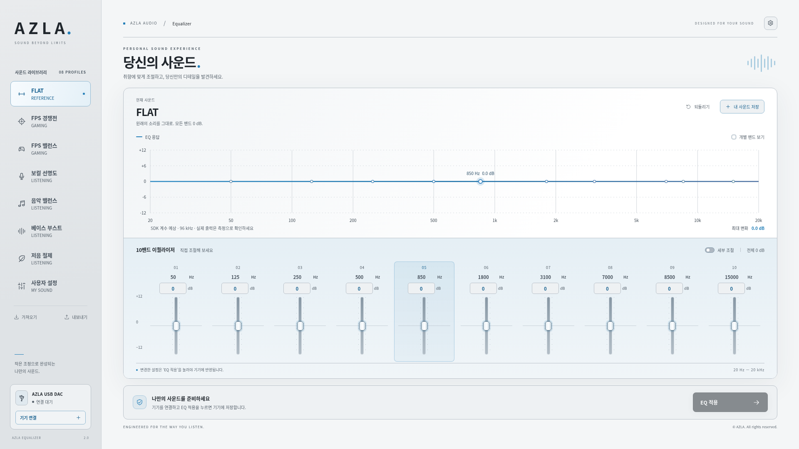

# AZLA Equalizer 2.0

AZLA USB DAC를 위한 화이트·실버 디자인의 10밴드 EQ 프로그램입니다. 기존 프로그램에서 쓰던 **제조사 원본 SDK를 포함**하며, **EQ 적용** 버튼으로 10밴드와 RAM 반영 후 Flash 저장 명령을 보냅니다.



## 바로 실행하기

Windows 단독 실행본은 [Releases](https://github.com/tjdrua1123-art/AZLA/releases)에서 `AZLA-Equalizer-Windows.zip`을 받아 전체 압축을 풀고 `AZLA Equalizer.exe`를 실행합니다. 실행본이 아직 빌드 중이면 아래 소스 실행 방법을 사용할 수 있습니다.

1. 이 저장소의 **Code → Download ZIP**으로 내려받습니다.
2. ZIP을 **폴더 전체로 압축 해제**합니다. `sdk`와 `src` 폴더도 필요합니다.
3. `start_windows.bat`를 실행합니다. 기존 프로그램을 실행하던 Python 3 환경을 그대로 사용할 수 있고, Python이 없으면 설치된 Node.js를 사용합니다.
4. Windows **Chrome 또는 Edge**에서 `http://localhost:8768`을 엽니다. 서버 창은 사용 중 열어 둡니다.
5. **기기 연결**에서 본인의 AZLA DAC를 선택합니다.
6. 사운드 라이브러리를 선택하거나 EQ를 조절하고 **EQ 적용**을 누릅니다. 저장 중 USB를 분리하지 마세요.

구버전 서버는 먼저 종료하세요. 이전 화면이 보이면 `Ctrl+Shift+R`로 새로고침합니다. Git으로 받은 폴더는 로컬 변경을 확인한 뒤 `git pull`로 갱신할 수 있습니다.

## 기능

- FLAT 초기 화면, 10밴드 주파수·게인, 세부 조절의 공통 Q 0.75·필터 선택
- FLAT, FPS 경쟁전·밸런스, 보컬, 음악, 베이스, 저음 절제, 사용자 설정
- 내 사운드 저장, JSON 백업·복원, 기존 8밴드 설정 이관
- SDK 정수 계수 기반 예상 응답, REW EQ OFF·ON 비교
- 단일 **EQ 적용**으로 10밴드 → RAM 반영 → Flash 저장 명령 순차 전송

현재 연결 설정은 기존 프로그램과 같은 제조사 VID 검색 방식입니다. PID를 직접 입력할 필요 없이 본인의 AZLA DAC를 선택합니다. 출력 Report 75를 확인하며, 슬라이더·라이브러리 변경만으로 기기에 쓰지 않습니다.

## 검증 범위

기본 단위 검증 34개와 **원본 SDK + 모의 HID 통합 검증 11개**가 통과했습니다. 실제 Flash 명령이 3바이트임을 확인하고, 이를 7바이트로 잘못 검사하던 새 코드의 오류를 수정했습니다. SDK 원본은 변경하지 않았습니다.

사용자는 기존 프로그램에서 실제 Flash 저장이 동작했다고 확인했습니다. 이 환경에는 실제 DAC가 없어 **새 버전의 기기 통신과 전원 재연결 후 보존은 실기로 확인해야 합니다.** 완료 표시는 저장 명령 전송 완료입니다. 사운드 라이브러리는 제공된 초록·주황 원음 응답의 상대적인 형태를 참고한 시작값이며 최종 튜닝은 청음·측정으로 확정해야 합니다.

- [사용 방법](docs/사용방법.md)
- [사운드 라이브러리 튜닝 근거](docs/사운드_라이브러리_튜닝.md)
- [검증 결과](docs/검증결과.md)
- [출시 전 실기 검증](docs/출시검증.md)

## 개발 및 Windows 앱 패키징

브라우저 실행에는 npm 설치가 필요하지 않습니다. 개발용 Node 서버는 `node server.mjs`로 실행합니다.

```powershell
npm ci
npm run desktop
```

```powershell
npm run package:folder
npm run package:win
```

첫 명령은 설치 없는 Windows 앱 폴더, 두 번째는 NSIS 설치 프로그램을 생성합니다. 패키징한 앱의 사용자는 Python이나 Node.js를 따로 설치하지 않습니다. Windows 실행·설치·코드 서명은 별도 검증 대상입니다.
