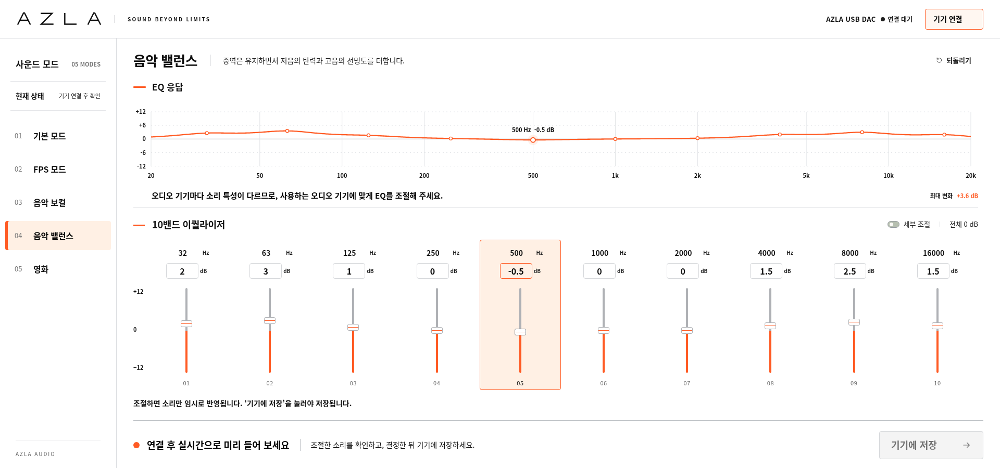

# AZLA Equalizer 2.0

AZLA USB DAC를 위한 10밴드 EQ 프로그램입니다. **제조사 원본 SDK를 포함**하며, 연결 후 EQ를 조절하면 RAM에 임시 반영해 미리 듣고, **기기에 저장**을 눌렀을 때만 Flash 저장 명령을 보냅니다.



승인된 화이트·선명한 오렌지 시안을 적용했습니다. 로고와 기기 연결은 상단에, 모드는 왼쪽 목록에 배치했습니다. `#FF5B24`를 저장 버튼·응답 곡선·슬라이더·선택 표시에 사용하고 `#FFF0E4`를 선택 배경에 사용합니다. 저장 안내와 버튼은 PC에서 스크롤 없이 보이며, 모바일은 모드·밴드를 가로로 넘겨 사용할 수 있습니다. 프리셋·SDK·RAM 미리듣기와 Flash 저장 동작은 유지합니다.

## 바로 실행하기

Windows 단독 실행본은 [Releases](https://github.com/tjdrua1123-art/AZLA/releases)에서 `AZLA-Equalizer-Windows.zip`을 받아 전체 압축을 풀고 `AZLA Equalizer.exe`를 실행합니다. 실행본이 아직 빌드 중이면 아래 소스 실행 방법을 사용할 수 있습니다.

1. 이 저장소의 **Code → Download ZIP**으로 내려받습니다.
2. ZIP을 **폴더 전체로 압축 해제**합니다. `sdk`와 `src` 폴더도 필요합니다.
3. `start_windows.bat`를 실행합니다. 기존 프로그램을 실행하던 Python 3 환경을 그대로 사용할 수 있고, Python이 없으면 설치된 Node.js를 사용합니다.
4. Windows **Chrome 또는 Edge**에서 `http://localhost:8768`을 엽니다. 서버 창은 사용 중 열어 둡니다.
5. **기기 연결**에서 본인의 AZLA DAC를 선택합니다.
6. 볼륨을 낮춘 뒤 모드나 EQ를 조절해 소리를 미리 듣습니다. 결정한 뒤 **기기에 저장**을 누릅니다. 저장 중 USB를 분리하지 마세요.

구버전 서버는 먼저 종료하세요. 이전 화면이 보이면 `Ctrl+Shift+R`로 새로고침합니다. Git으로 받은 폴더는 로컬 변경을 확인한 뒤 `git pull`로 갱신할 수 있습니다.

## 기능

- 매 실행 기본 모드 초기 화면, 10밴드 주파수·게인, 세부 조절의 공통 Q 1.4·필터 선택
- 기본 모드, FPS 모드, 음악 보컬, 음악 밸런스, 영화
- 기본·음악·영화 대역: 32·63·125·250·500 Hz, 1·2·4·8·16 kHz (32 Hz는 명목 31.5 Hz의 정수 근사)
- SDK 정수 계수 기반 예상 응답, REW EQ OFF·ON 비교
- 슬라이더·수치·그래프·모드 변경을 RAM에 임시 반영하는 실시간 미리듣기
- **기기에 저장**으로 10밴드 → RAM 반영 → Flash 저장 명령 순차 전송
- 기본 모드 위 **현재 상태**에서 기기의 EQ Tag와 마지막 Flash 전송값 확인

현재 연결 설정은 기존 프로그램과 같은 제조사 VID 검색 방식입니다. PID를 직접 입력할 필요 없이 본인의 AZLA DAC를 선택합니다. 출력 Report 75를 확인합니다. 연결만으로 EQ를 덮어쓰지 않으며, 이후 조절은 RAM에만 반영합니다. 예상 최대 상승이 +6 dB를 넘으면 자동 미리듣기를 보류하고 **볼륨 확인 후 미리듣기**를 표시합니다. 이 확인은 Flash에 저장하지 않습니다.

사용자 사운드 저장·가져오기·내보내기는 제거했습니다. 수동 조절값은 현재 실행 중에만 유지되고 다시 실행하면 기본 모드로 시작합니다. 새 버전을 처음 실행할 때 v1~v4의 기존 사용자 저장 키를 삭제하며, 연결 오류 시 표시되는 진단 창의 **진단 기록 저장**은 장치 문제 확인을 위해 유지합니다.

**현재 상태**는 연결 시 실제 EQ Tag ID를 읽습니다. 미리듣기 중에는 이번 세션에 RAM으로 보낸 값을 ‘미리듣기 중 · 저장 전’으로 구분하며 마지막 Flash 전송 기록을 덮어쓰지 않습니다. 제조사 SDK에는 Flash의 10개 밴드를 다시 읽는 API가 없으므로, 그 외에는 마지막 Flash 전송 기록을 Tag와 대조해 표시합니다. 기록이 없는 기본 모드는 Tag에 해당하는 기준값을 표시하고, 알 수 없는 Tag는 상세 값을 표시하지 않습니다.

## 검증 범위

단위 검증과 **원본 SDK + 모의 HID 통합 검증**으로 RAM 전용 미리듣기, 최신 편집값 병합, 저장 전 전송 대기, 명시적 저장당 Flash 1회, 큰 증폭 확인, 오류 시 재연결을 확인합니다. 실제 Flash 명령은 3바이트입니다. SDK 원본은 변경하지 않았습니다. [검증 결과](docs/검증결과.md)에 재현 방법을 기록했습니다.

사용자는 기존 프로그램에서 실제 Flash 저장이 동작했다고 확인했습니다. 이 환경에는 실제 DAC가 없어 **새 버전의 기기 통신과 전원 재연결 후 보존은 실기로 확인해야 합니다.** 완료 표시는 저장 명령 전송 완료입니다. 네 가지 용도별 모드는 공개 음향 자료와 첨부 제안서를 바탕으로 모드별 핵심 대역을 강조했습니다. 정확한 게인은 자체 설계값이며 이어폰별 최적값은 아닙니다. SDK 합성·누적 최대 상승은 +5.5 dB 이하로 검증했으며, 최종값은 청음·측정으로 확정해야 합니다.

- [사용 방법](docs/사용방법.md)
- [사운드 라이브러리 튜닝 근거](docs/사운드_라이브러리_튜닝.md)
- [검증 결과](docs/검증결과.md)
- [출시 전 실기 검증](docs/출시검증.md)

## 개발 및 Windows 앱 패키징

브라우저 실행에는 npm 설치가 필요하지 않습니다. 개발용 Node 서버는 `node server.mjs`로 실행합니다.

```powershell
npm ci
npm run desktop
```

```powershell
npm run package:folder
npm run package:win
```

첫 명령은 설치 없는 Windows 앱 폴더, 두 번째는 NSIS 설치 프로그램을 생성합니다. 패키징한 앱의 사용자는 Python이나 Node.js를 따로 설치하지 않습니다. Windows 실행·설치·코드 서명은 별도 검증 대상입니다.

FPS는 PUBG·VALORANT의 공개 게임 음향 분석을 참고해 125 Hz를 보강하고 9번째 대역을 8 kHz에서 6 kHz로 변경했습니다. 실제 게임 녹음으로 확정한 최적값은 아니며, 자세한 근거는 docs/FPS_게임_음향_검토.md에 기록했습니다.
